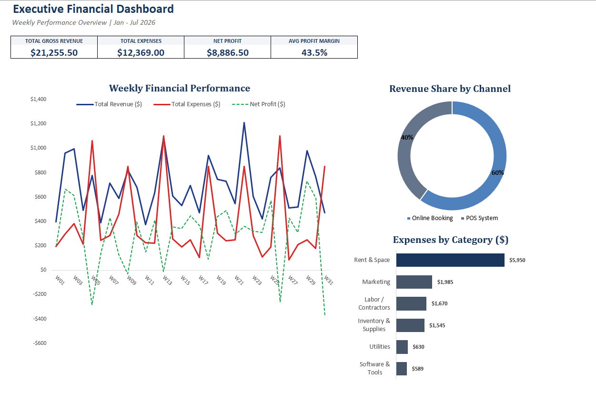
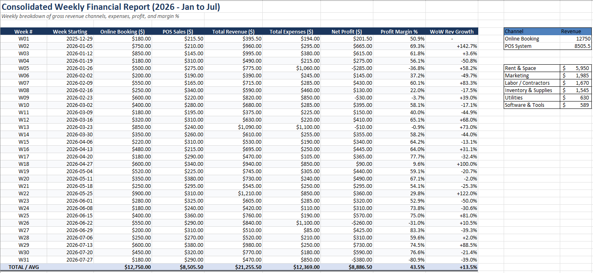
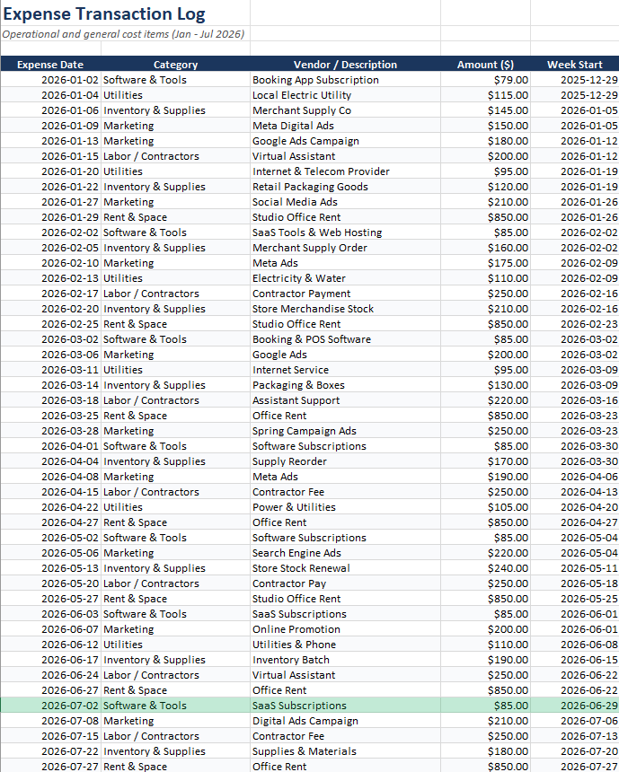

# Consolidated Financial & KPI Model (Microsoft Excel)

An end-to-end 31-week financial tracking model and executive dashboard built in Microsoft Excel to monitor multi-channel gross revenue, categorize operational expenses, and analyze how fixed-cost timing impacts weekly liquidity and profit margins.

---

## 📊 Executive Dashboard Overview

### Summary Performance Metrics (Jan – Jul 2026)
| Metric | Value | Notes |
| :--- | :--- | :--- |
| **Total Gross Revenue** | **$21,255.50** | Combined inflows across 31 operational weeks |
| **Online Booking Revenue** | **$12,750.00** | 60% of total gross revenue share |
| **POS System Sales** | **$8,505.50** | 40% of total gross revenue share |
| **Total Operating Expenses** | **$12,369.00** | Tracked across 6 core cost categories |
| **Net Profit** | **$8,886.50** | Overall cumulative net earnings |
| **Average Profit Margin** | **43.5%** | +13.5% average Week-over-Week (WoW) revenue growth |

---

## 📑 Model Architecture & Workflow

### 1. Consolidated Weekly Financial Report

* **Multi-Channel Revenue Aggregation:** Automated weekly roll-ups comparing Online Bookings against physical POS System sales from W01 to W31.
* **Margin & Growth Tracking:** Dynamic calculation of weekly Net Profit ($), Profit Margin (%), and rolling Week-over-Week (WoW) revenue growth rates without manual formula plugs.
* **Cross-Sheet Reconciliation:** Embedded summary verification tables reconciling channel totals and expense categories against the granular ledger.

### 2. Granular Expense Transaction Log

* **Standardized Cost Categorization:** Maps every operational expenditure across six standardized cost centers: *Rent & Space*, *Marketing*, *Labor / Contractors*, *Inventory & Supplies*, *Utilities*, and *Software & Tools*.
* **Date-Driven Mapping:** Assigns each transaction date to its corresponding `Week Start` period for error-free conditional aggregation (`SUMIFS` / `XLOOKUP`).

---

## 💡 Key Financial Insights
1. **Channel Concentration:** Digital bookings generate **60% ($12,750.00)** of total top-line revenue compared to **40% ($8,505.50)** from physical POS transactions, indicating strong reliance on online conversion funnels.
2. **Fixed Overhead Dominance:** **Rent & Space ($5,950.00)** accounts for **48.1%** of total operating expenses—exceeding the combined spend on **Marketing ($1,985.00)** and **Labor/Contractors ($1,670.00)**.
3. **Weekly Liquidity & Cash Flow Timing:** Despite maintaining a strong **43.5% cumulative profit margin**, the weekly performance tracker exposes short-term negative net cash flows during **W05 (-$285.00)**, **W09 (-$30.00)**, **W13 (-$10.00)**, **W26 (-$260.00)**, and **W31 (-$380.00)**. These dips occur specifically in weeks when the **$850.00 monthly studio rent** hits the ledger alongside cyclical dips in online bookings—highlighting the importance of accrual reserves for smoothing fixed monthly overhead.

---

## 🛠️ Technical Skills Demonstrated
* **Spreadsheet Modeling:** Dynamic aggregation (`SUMIFS`, `XLOOKUP`), rolling percentage variance formulas, error trapping, and structured ledger design.
* **Financial Analysis:** Revenue channel segmentation, cost-center auditing, margin analysis, and cash-flow timing diagnostics.
* **Data Visualization:** Executive KPI cards, multi-series weekly performance line charts, channel share doughnut charts, and horizontal cost distribution bars.

---

💼 **Connect with me:** [LinkedIn](https://www.linkedin.com/in/chukwuebuka-ugwuoke-60a664419) | [Hire me on Upwork](https://www.upwork.com/freelancers/~01edd8baecf9e9d6a9)
